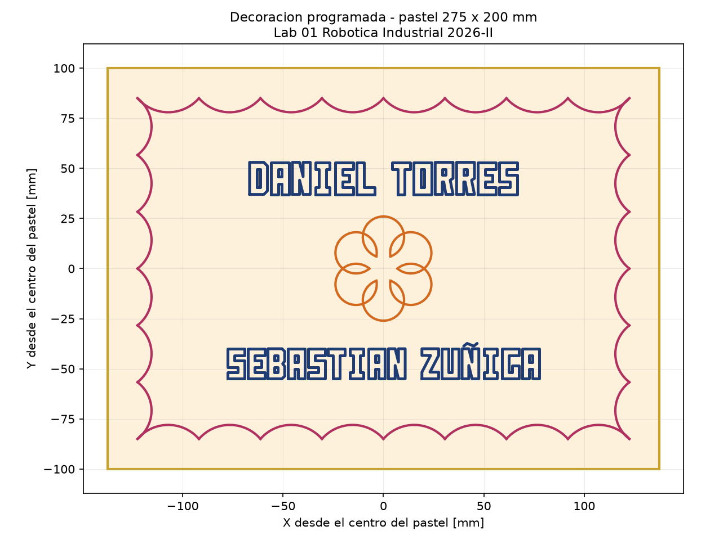
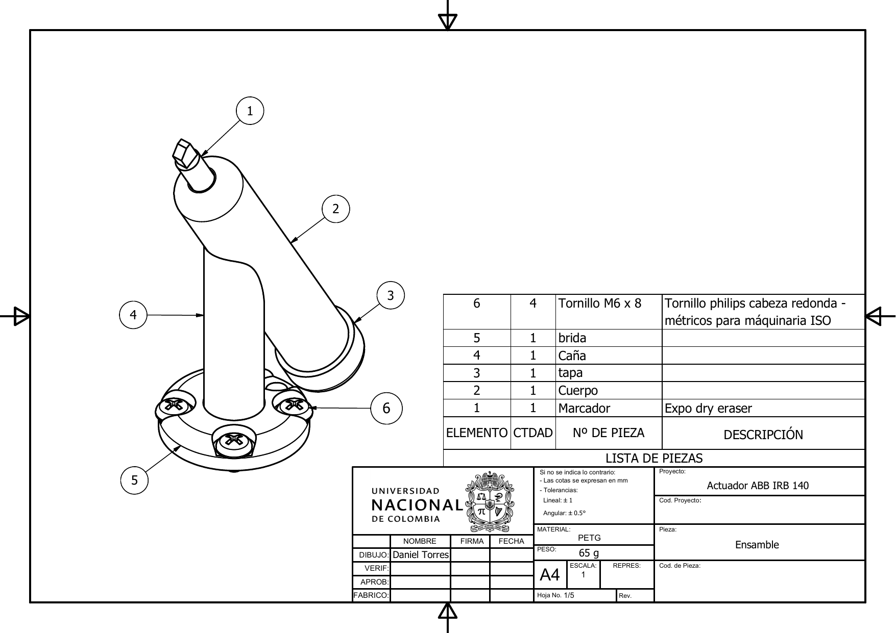
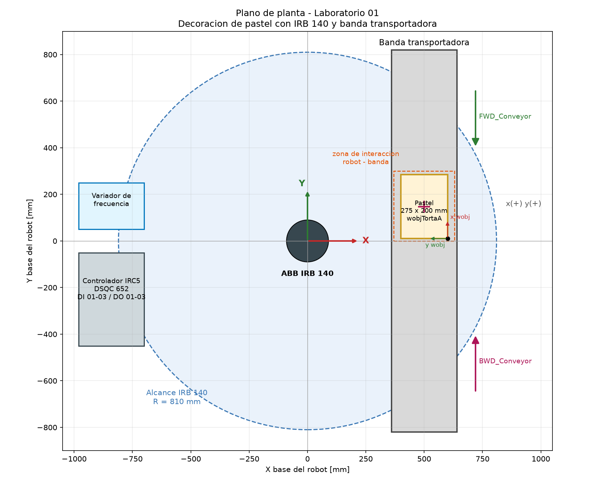
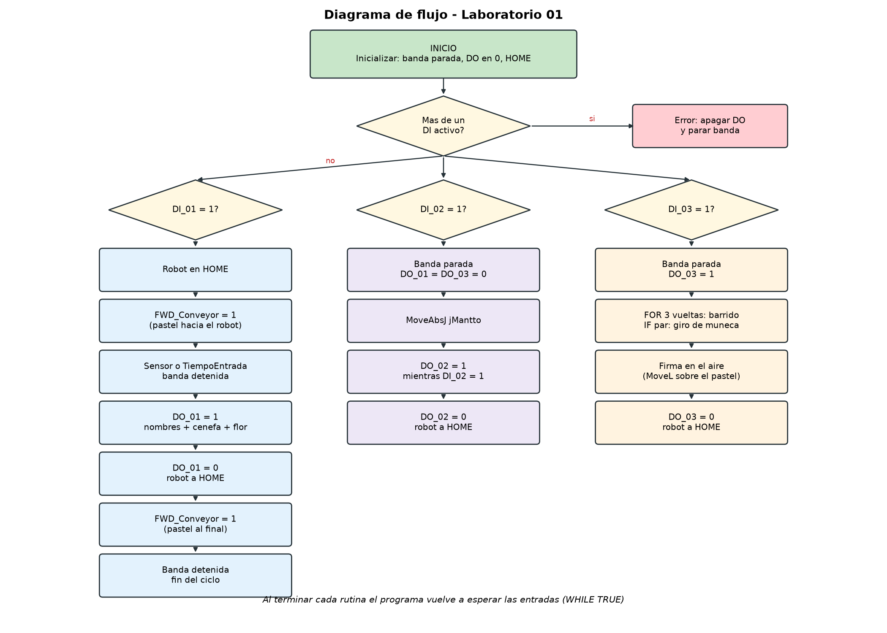
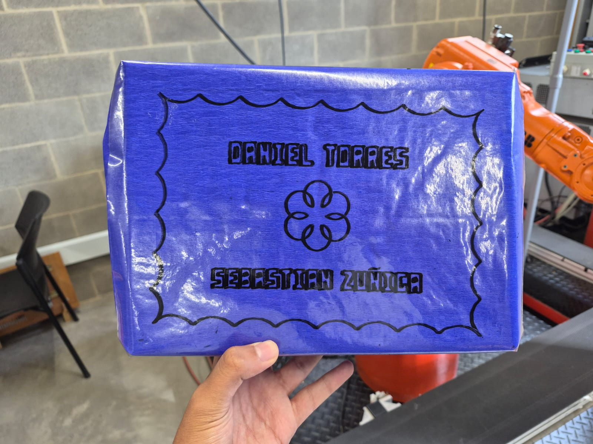
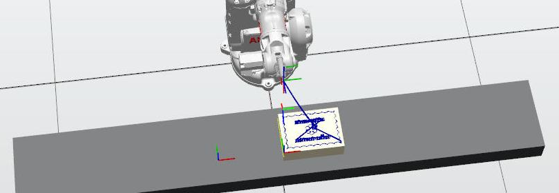

<div align="center">

<picture>
  <source srcset="https://imgur.com/5bYAzsb.png" media="(prefers-color-scheme: dark)">
  <source srcset="https://imgur.com/Os03JoE.png" media="(prefers-color-scheme: light)">
  
</picture>

# Lab 01 - Robótica Industrial ABB IRB140 y RobotStudio

## Grupo 3C

<p>
  
  
  
  
</p>

</div>

<div align="justify">

## 👥 Integrantes del grupo

| Integrante | Correo | GitHub |
|---|---|---|
| Daniel Alejandro Torres Sanabria | datorressa@unal.edu.co | [@DanielTorresS](https://github.com/DanielTorresS) |
| Janpier Sebastian Zuñiga Ramos | jzunigar@unal.edu.co | [@jzunigar](https://github.com/jzunigar) |

## 🎯 Objetivos

- Implementar una celda simplificada de decoración automática de un pastel: la banda transportadora lleva el pastel hasta el robot, el robot escribe los nombres del grupo y una decoración propia, vuelve a HOME y la banda saca el pastel decorado.
- Trabajar las trayectorias con `MoveJ`, `MoveL`, `MoveC` y `MoveAbsJ`, los sistemas de coordenadas de herramienta (TCP, `tooldata`) y de trabajo (`wobjdata`), la calibración de la herramienta, la programación intermedia en RAPID (procedimientos, funciones, `FOR`, `WHILE`, `IF` y manejo de errores) y las entradas y salidas digitales del IRC5.
- Integrar el robot con la banda mediante señales digitales y enclavamientos, con tres modos de operación: ciclo de decoración (DI_01), pose de mantenimiento (DI_02) y rutina Farmear Aura (DI_03).
- Comparar la calibración de la herramienta Mark1 hecha en RobotStudio con la hecha en el robot real.
- Equipos empleados: robot ABB IRB 140 con controlador IRC5 y módulo DSQC 652, banda transportadora bidireccional, herramienta portamarcador Mark1 impresa en 3D y RobotStudio.

## 🧰 Recursos utilizados

- **Robot / simulador:** ABB IRB 140 con controlador IRC5 y módulo de entradas y salidas DSQC 652; banda transportadora bidireccional con su variador de frecuencia; RobotStudio para simular la celda completa.
- **Software:** RobotStudio (estaciones, creación de la herramienta y simulación), Autodesk Inventor (diseño de Mark1, exportado a `.sat`) y FlexPendant (calibración del TCP y ajuste del workobject).
- **Lenguaje / entorno:** RAPID en el controlador IRC5 (real y virtual).
- **Evidencias adjuntas:**

| Carpeta | Contenido |
|---|---|
| [`rapid/robot_real/`](rapid/robot_real/) | Módulos cargados en el robot real: decoración y Farmear Aura |
| [`rapid/simulacion/`](rapid/simulacion/) | Programa completo de la celda (`decoracion_banda`), solo decoración y solo Farmear Aura |
| [`rapid/calibracion/`](rapid/calibracion/) | Puntos y resultado de la calibración TCP de Mark1 |
| [`robotstudio/`](robotstudio/) | Estaciones de RobotStudio (Pack and Go, `.rspag`) |
| [`cad/Herramienta_marcador.sat`](cad/Herramienta_marcador.sat) | Modelo CAD de la herramienta Mark1 |
| [`cad/Planos_actuador.pdf`](cad/Planos_actuador.pdf) | Planos de Mark1: ensamble, cuerpo, tapa, caña y brida |
| [`media/`](media/) | Fotos, videos, diagrama de flujo y plano de planta |
| [`guia/`](guia/) | Guía del laboratorio |

## 📝 Desarrollo

La celda decora un pastel representado por una caja forrada de 275 × 200 mm, que equivale más o menos a un pastel para 20 personas. La decoración tiene tres partes:

- Los nombres **DANIEL TORRES** (arriba) y **SEBASTIAN ZUÑIGA** (abajo), separados por la flor del centro.
- Una cenefa ondulada alrededor de todo el borde.
- Una flor de seis pétalos en el centro.

Las letras son de bloque y se trazan con `MoveL`; la cenefa y la flor son arcos y se trazan con `MoveC`. Cada palabra se dibuja con trazo continuo y el marcador solo se levanta entre letras o figuras.

<p align="center">
  
</p>

### 1. Preparación

#### Herramienta Mark1

Mark1 es un portamarcador que se atornilla al flange del IRB 140. Se diseñó en Autodesk Inventor y se fabricó en PETG por impresión 3D; el ensamble pesa 65 g. El modelo está en [`cad/Herramienta_marcador.sat`](cad/Herramienta_marcador.sat) y se importó a RobotStudio para crear la herramienta. Los planos de fabricación están en [`cad/Planos_actuador.pdf`](cad/Planos_actuador.pdf) (cotas en mm, tolerancias de ±1 mm lineal y ±0.5° angular).

| Elemento | Pieza | Cant. | Descripción | Peso |
|---|---|---|---|---|
| 1 | Marcador | 1 | Expo dry eraser | — |
| 2 | Cuerpo | 1 | Tubo de 115 mm que aloja el marcador, con rosca M24 × 2.5 en un extremo y el acople a la caña inclinado 30° | 29 g |
| 3 | Tapa | 1 | Tapa roscada M24 × 2.5 (Ø28 × 12 mm) que cierra el cuerpo | 4 g |
| 4 | Caña | 1 | Tubo de Ø20 × 70 mm (Ø15 interior) que une la brida con el cuerpo; su base tiene una lengüeta de 5 × 4 mm | 15 g |
| 5 | Brida | 1 | Disco de Ø50 × 10 mm que se apoya en el flange, con los agujeros para M6 en un círculo de Ø40 y la ranura de la lengüeta de la caña | 16 g |
| 6 | Tornillo M6 × 8 | 4 | Phillips de cabeza redonda, métrico ISO | — |

- El **cuerpo** sostiene el marcador inclinado 30° respecto al eje del flange. Así la muñeca no choca con el pastel y la punta y el trazo se ven en el video.
- Los tornillos y la lengüeta de la caña, que entra en la ranura de la brida, evitan que la herramienta gire.
- Medidas generales del modelo: aprox. 50 × 127 × 81 mm.

<p align="center">
  
</p>

En los módulos de decoración la herramienta se declara como `tMarcador`, con los valores de Mark1 obtenidos en RobotStudio:

```rapid
TASK PERS tooldata tMarcador := [TRUE, [[22.659, -2.093, 127.403], [0.965925826, 0, 0.258819045, 0]],
                                 [0.25, [0, 0, 62], [1, 0, 0, 0], 0, 0, 0]];
```

El cuaternión `[0.965926, 0, 0.258819, 0]` es la rotación de 30° en Y del marcador; la masa es 0.25 kg con centro de gravedad en [0, 0, 62] mm.

#### Calibración de Mark1: RobotStudio vs. robot real

- **RobotStudio:** se importó el `.sat`, se puso el origen local en la cara que va al flange y con *Create Tool* se definió el TCP en la punta del marcador ([`MOD_Estacion.mod`](rapid/simulacion/decoracion_banda/MOD_Estacion.mod)).
- **Robot real:** se usó el método TCP de 4 puntos en el FlexPendant, llevando la punta del marcador al mismo punto fijo con cuatro orientaciones distintas del robot. Los puntos están en [`TCP_Mark1.mod`](rapid/calibracion/TCP_Mark1.mod) y el resultado en [`lapicigno.mod`](rapid/calibracion/lapicigno.mod).

| Parámetro | RobotStudio | Robot real | Diferencia |
|---|---|---|---|
| x [mm] | 22.659 | 33.787 | +11.13 |
| y [mm] | −2.093 | 1.528 | +3.62 |
| z [mm] | 127.403 | 120.176 | −7.23 |
| Distancia entre TCP | | | **13.75 mm** |
| Orientación (cuaternión) | [0.966, 0, 0.259, 0] (30° en Y) | [1, 0, 0, 0] | ver análisis |

#### Celda y plano de planta

Todas las coordenadas están en mm respecto a la base del robot (`wobj0`).

| Elemento | Ubicación |
|---|---|
| Robot ABB IRB 140 | Origen (0, 0). Alcance máximo 810 mm |
| Banda transportadora | Frente al robot, paralela al eje Y. Bidireccional (`FWD_Conveyor` / `BWD_Conveyor`) |
| Pastel en la banda (`wobjTortaA`) | Origen (600, 10, 129) en el robot real (z = 180 en simulación); centro aprox. (500, 147.5); cuadrante x(+), y(+) |
| Controlador IRC5 + DSQC 652 | Lado x(−), fuera del área de trabajo |
| Variador de la banda | Lado x(−), junto al controlador |

- Base del robot al centro del pastel: aprox. 521 mm. Esquina más lejana del pastel (600, 285): aprox. 664 mm, menor que los 810 mm de alcance.
- **Zona de interacción:** el rectángulo alrededor del pastel sobre la banda. Mientras el robot está ahí (`bRobotEnZona = TRUE`) la banda no se puede mover.

<p align="center">
  
</p>

#### Workobjects

El workobject del pastel, `wobjTortaA`, está girado 90° en Z (`q = [0.707107, 0, 0, 0.707107]`), por eso el eje x del pastel queda en la dirección +Y del robot, que es la dirección de la banda. El punto `pPlano` es el centro del pastel, (137.5, 100, 0) dentro del workobject, y todas las trayectorias se definen relativas a él.

```rapid
TASK PERS wobjdata wobjTortaA := [FALSE, TRUE, "", [[600, 10, 180], [0.707107, 0, 0, 0.707107]],
                                  [[0, 0, 0], [1, 0, 0, 0]]];
```

#### Señales digitales (DSQC 652)

| Señal | Dirección | Función |
|---|---|---|
| `DI_01` | 0 | Inicia el ciclo automático de decoración |
| `DI_02` | 1 | Lleva el robot a la pose de mantenimiento |
| `DI_03` | 2 | Inicia la rutina Farmear Aura |
| `DI_Sensor` | 3 | Detección del pastel en la estación (opcional; si no, por tiempo) |
| `DO_01` | 0 | Robot decorando |
| `DO_02` | 1 | Robot en posición de mantenimiento |
| `DO_03` | 2 | Robot farmeando aura |
| `FWD_Conveyor` | 3 | Banda hacia adelante |
| `BWD_Conveyor` | 4 | Banda hacia atrás |

La configuración de las señales está en `EIO_Lab01.cfg` (controlador real) y `EIO_Lab01_Sim.cfg` (señales virtuales para RobotStudio).

### 2. Implementación

#### Trayectorias en tablas

Las trayectorias se guardan en tablas (arreglos `num`) con coordenadas relativas a `pPlano`:

- `tblNombre1` (DANIEL TORRES, 181 puntos) y `tblNombre2` (SEBASTIAN ZUÑIGA, 235 puntos). Cada punto es `[x, y, estado]`: `0` marcador arriba, `2` bajar el marcador, `1` dibujando.
- `tblCenefa` (28 arcos) y `tblFlor` (12 arcos), cada fila `[inicio, medio, fin]`.
- `TrazarTabla` recorre los puntos con un `FOR` y, según el estado, hace `MoveL` a la altura segura o sobre el pastel. `TrazarArcos` recorre los arcos con `MoveC`.
- Cada punto se calcula como `Offs(pPlano, x, y, z)` dentro de `wobjTortaA` (`DecorarTorta wobjTortaA`), así que si el pastel cambia de lugar basta con redefinir el workobject.

#### Organización del código

El programa de la celda completa ([`rapid/simulacion/decoracion_banda/`](rapid/simulacion/decoracion_banda/)) está dividido en módulos:

| Módulo | Contenido |
|---|---|
| [`MOD_Datos.sys`](rapid/simulacion/decoracion_banda/MOD_Datos.sys) | Herramienta, workobjects, `pPlano`, HOME, pose de mantenimiento, posiciones de Farmear Aura, velocidades y tiempos de la banda |
| [`MOD_Banda.mod`](rapid/simulacion/decoracion_banda/MOD_Banda.mod) | `ConveyorForward`, `ConveyorBackward`, `ConveyorStop`, enclavamientos, transporte de entrada y salida y `DemoBidireccional` |
| [`MOD_Texto.mod`](rapid/simulacion/decoracion_banda/MOD_Texto.mod) | Tablas de puntos de los nombres, `TrazarTabla` y `TrazarNombres` |
| [`MOD_Deco.mod`](rapid/simulacion/decoracion_banda/MOD_Deco.mod) | Tablas de arcos de la cenefa y la flor, `TrazarArcos` y `TrazarDecoracion` |
| [`MOD_Estacion.mod`](rapid/simulacion/decoracion_banda/MOD_Estacion.mod) | Herramienta Mark1 y punto home creados en RobotStudio |
| [`MOD_Main.mod`](rapid/simulacion/decoracion_banda/MOD_Main.mod) | `main` con el `WHILE` que revisa DI_01, DI_02 y DI_03, el ciclo de decoración, mantenimiento, Farmear Aura y funciones de apoyo |

Para el robot real se cargaron dos módulos autocontenidos ([`rapid/robot_real/`](rapid/robot_real/)):

- [`MOD_SoloDecoracion.mod`](rapid/robot_real/MOD_SoloDecoracion.mod): nombres, cenefa y flor con todas las velocidades en `v100` y `wobjTortaA` a z = 129 mm. `IrAHome` sube 120 mm con `CRobT` y va a `jHome` con `MoveAbsJ`.
- [`MOD_FarmearAura.mod`](rapid/robot_real/MOD_FarmearAura.mod): la coreografía con DO_03, a `v500` y zona `z10`.

#### Lógica de operación

El `main` inicializa la celda (banda parada, DO_01 a DO_03 en 0, robot en HOME) y entra en un `WHILE TRUE` que revisa las entradas. Si hay más de un DI activo no ejecuta ninguna rutina: apaga las salidas, para la banda y espera a que quede uno solo.

<p align="center">
  
</p>

**Ciclo automático (DI_01)**

1. El robot va a HOME.
2. Se activa `FWD_Conveyor` y la banda lleva el pastel hacia el robot.
3. La banda se detiene con `DI_Sensor` o por tiempo (`TiempoEntrada`).
4. Se revisa que la banda esté detenida (`BandaDetenida`) y que `pPlano` sea alcanzable (`CalcJointT`); si algo falla, el programa se detiene.
5. `DO_01 = 1` y se dibujan los nombres, la cenefa y la flor.
6. `DO_01 = 0`, el robot sube 120 mm y vuelve a HOME.
7. Con el robot fuera de la zona, se activa otra vez la banda y lleva el pastel al final (`TiempoSalida`).
8. La banda se detiene y termina el ciclo; el programa espera a que se suelte DI_01.

**Pose de mantenimiento (DI_02)**

Se para la banda, se apagan DO_01 y DO_03 y el robot va a `jMantto = [0, -25, -15, 0, 45, 0]`. En esa pose se activa DO_02 y el robot se queda ahí mientras DI_02 siga en 1. Al bajar DI_02 se apaga DO_02 y el robot vuelve a HOME. La pose deja Mark1 y el marcador accesibles para cambiarlo o revisarlo.

**Farmear Aura (DI_03)**

Con la banda parada se activa DO_03. El robot hace un barrido de lado a lado tres veces (`FOR`) entre `jAura1` y `jAura2`, y en las vueltas pares gira la muñeca (`IF i MOD 2 = 0`, entre `jAura3` y `jAura4`). Después hace una "firma" en el aire encima del pastel con `MoveL`, termina con una reverencia y vuelve a HOME. Al final `DO_03 = 0`. La rutina dura entre 10 y 20 s.

#### Banda bidireccional y seguridad

| FWD_Conveyor | BWD_Conveyor | Estado |
|---|---|---|
| 1 | 0 | Adelante |
| 0 | 1 | Atrás |
| 0 | 0 | Detenida |
| 1 | 1 | **Prohibido** |

- Antes de activar un sentido se resetea el otro, se espera 0.3 s y se verifica con `DOutput`. Si la otra señal sigue activa el programa se detiene.
- La bandera `bRobotEnZona` impide mover la banda mientras el robot está encima del pastel.
- Si hay más de un DI activo no se ejecuta nada, se apagan las salidas y se para la banda.
- Antes de decorar se comprueba con `CalcJointT` que el punto sea alcanzable (manejador `ERROR` para `ERR_ROBLIMIT` y `ERR_OUTSIDE_REACH`).
- El marcador baja al pastel a `v100` con zona `fine`. Todas las velocidades están entre `v100` y `v500` y la zona máxima es `z10`.
- `DemoBidireccional` mueve la banda 3 s adelante, la para, 3 s atrás y la para, para mostrar los dos sentidos.

#### Instrucciones y funciones de RAPID utilizadas

| Instrucción / función | Uso en el programa |
|---|---|
| `MoveJ` | Llegar encima del centro del pastel y firma de Farmear Aura |
| `MoveL` | Escribir las letras, bajar y subir el marcador y subir 120 mm antes de ir a HOME |
| `MoveC` | Cenefa (28 arcos) y flor (12 arcos) |
| `MoveAbsJ` | HOME, pose de mantenimiento y posiciones de Farmear Aura |
| `ConfJ \Off` / `ConfL \Off` | Evitar que el robot se detenga por cambios de configuración durante las trayectorias |
| `Offs` | Calcular cada punto de las tablas respecto a `pPlano` |
| `CRobT` | Leer la posición actual para subir 120 mm antes de ir a HOME |
| `CalcJointT` | Comprobar en `PuntoAlcanzable` que el pastel esté dentro del alcance |
| `Dim` | Recorrer las tablas sin fijar su tamaño |
| `Set` / `Reset` | Activar y desactivar DO_01, DO_02, DO_03, `FWD_Conveyor` y `BWD_Conveyor` |
| `DOutput` | Leer el estado de las salidas en los enclavamientos y en `BandaDetenida` |
| `WaitDI` | Esperar `DI_Sensor` (con `\MaxTime` y `\TimeFlag`) y que se suelte DI_01 o DI_03 |
| `WaitUntil` | Esperar a que quede un solo DI activo |
| `WaitTime` | Tiempos de banda, tiempo muerto al cambiar de sentido y espera de frenado |
| `PROC` | `CicloDecoracion`, `DecorarTorta`, `TrazarNombres`, `TrazarTabla`, `TrazarArcos`, `ModoMantenimiento`, `FarmearAura`, `HomeRobot`, `ConveyorForward`, `ConveyorBackward`, `ConveyorStop`, etc. |
| `FUNC` | `ModosActivos` (num), `BandaDetenida` (bool), `PuntoAlcanzable` (bool) |
| `WHILE` | Lazo principal del `main` y espera en la pose de mantenimiento |
| `FOR` | Recorrido de las tablas de puntos y vueltas de Farmear Aura |
| `IF` / `ELSEIF` | Selección del modo según los DI, estado del marcador y vueltas pares (`MOD`) |
| `ERROR` | Manejo de `ERR_ROBLIMIT` y `ERR_OUTSIDE_REACH` en `PuntoAlcanzable` |
| `Stop` | Detener el programa cuando falla un enclavamiento |
| `TPErase` / `TPWrite` | Mostrar en el FlexPendant la etapa en la que va el programa |

Tipos de dato usados: `tooldata` (`tMarcador`, Mark1), `wobjdata` (`wobjTortaA`), `robtarget` (`pPlano`, `Target_home`), `jointtarget` (`jHome`, `jMantto`, `jAura1` a `jAura4`), `speeddata` (`vTrazo`, `vAprox`, `vLento`, `vAura`), `num` (tablas, medidas y tiempos) y `bool` (`bRobotEnZona`, `bUsarSensor`, `bTimeout`).

### 3. Resultados

**En RobotStudio** se simuló:

- El ciclo completo con DI_01: la banda trae el pastel, se detiene, el robot decora con DO_01 activa, vuelve a HOME y la banda saca el pastel.
- La pose de mantenimiento (DI_02 / DO_02) y la rutina Farmear Aura (DI_03 / DO_03).
- El movimiento bidireccional de la banda con `DemoBidireccional`.

**En el robot real** se ejecutaron la decoración del pastel (nombres, cenefa y flor) y la rutina Farmear Aura. El pastel quedó decorado con los dos nombres, la cenefa y la flor, como se ve en la foto de evidencias. La prueba del ciclo completo con la banda en el robot real (banda llevando el pastel hasta el robot y robot decorándolo) queda pendiente.

**Evidencia de cada señal:**

| Señal | Función | Dónde se ve |
|---|---|---|
| DI_01 | Inicia el ciclo de decoración | Simulación con banda (video) |
| DI_02 | Lleva el robot a mantenimiento | Simulación (I/O Simulator) |
| DI_03 | Inicia Farmear Aura | `real_farmear_aura.mp4` y simulación |
| DO_01 | Activa mientras el robot decora | Simulación con banda (video) |
| DO_02 | Activa en la pose de mantenimiento | Simulación (I/O Simulator) |
| DO_03 | Activa durante Farmear Aura | `real_farmear_aura.mp4` y simulación |
| FWD_Conveyor | Banda hacia adelante | Simulación con banda (video) |
| BWD_Conveyor | Banda hacia atrás | `DemoBidireccional` en simulación |

### 4. Análisis

- **Calibración.** El método de 4 puntos solo calcula la posición del TCP y deja la orientación igual a la del flange, por eso en el robot real sale `[1, 0, 0, 0]` en lugar de los 30° en Y del modelo. Para obtener también el eje del marcador habría que usar el método TCP y Z.
- La diferencia en z (unos 7 mm) se explica porque el marcador real no entra igual que en el modelo y la punta de fieltro no es un punto exacto. Las diferencias en x e y vienen de las tolerancias de la impresión 3D, de la holgura al montar Mark1 en el flange y del error al llevar la punta al mismo punto cuatro veces a mano. El modelo de RobotStudio supone un robot y una pieza perfectos; el real no.
- En la prueba real se mantuvo `tMarcador` con los valores de Mark1 en RobotStudio y se ajustó la altura del workobject en la celda (z = 129 mm en lugar de 180 mm) hasta que el marcador tocara bien el pastel. Además, las velocidades de la decoración se bajaron a `v100`.
- **Reutilización de trayectorias.** Como todas las trayectorias son relativas a `pPlano` dentro de `wobjTortaA`, para pasar de la simulación al robot real solo hubo que cambiar la altura del workobject, sin tocar las tablas. Si el pastel se mueve, basta con volver a definir el workobject.
- **Tipos de movimiento.** `MoveL` es adecuado para las letras de bloque, que son segmentos rectos, y `MoveC` permite trazar la cenefa y la flor con pocos puntos (un arco por fila de la tabla) en lugar de aproximar las curvas con muchos segmentos.
- **Seguridad.** Los enclavamientos de la banda, la bandera `bRobotEnZona` y la regla de un solo DI activo garantizan que el robot no decore con la banda en movimiento y que la banda no arranque con el robot encima del pastel.

## 📷 Evidencias

**Video de la práctica (canal oficial LabSIR):** https://youtu.be/est3KcihayQ

**Resultado en el robot real**

<p align="center">
  
</p>

**Simulación en RobotStudio**

<p align="center">
  
</p>

**Videos**

| Video | Contenido |
|---|---|
| [`real_decoracion.mp4`](media/videos/real_decoracion.mp4) | Robot real decorando el pastel |
| [`real_farmear_aura.mp4`](media/videos/real_farmear_aura.mp4) | Robot real: rutina Farmear Aura con DO_03 |
| [`Pastelito_banda_DI_01`](media/videos/Pastelito_banda_DI_01%2010-20.mp4) · [v2](media/videos/Pastelito_banda_DI_01_v2%2010-20.mp4) | Simulación del ciclo DI_01: banda, decoración con DO_01 y salida del pastel |
| [`Pastelito_solo_decoracion`](media/videos/Pastelito_solo_decoracion_v2%2010-20.mp4) | Simulación de la decoración sola |
| [`Pastelito_farmear_aura`](media/videos/Pastelito_farmear_aura_v2%2010-20.mp4) | Simulación de Farmear Aura |

**Estaciones de RobotStudio** ([`robotstudio/`](robotstudio/))

- [`Pastelito decoracion en banda transportadora movible.rspag`](robotstudio/Pastelito%20decoracion%20en%20banda%20transportadora%20movible.rspag): ciclo con las entradas digitales; la banda trae el pastel, el robot decora y la banda lo saca.
- [`Pastelito solo decoracion.rspag`](robotstudio/Pastelito%20solo%20decoracion.rspag): solo la decoración del pastel.
- [`Pastelito farmear aura.rspag`](robotstudio/Pastelito%20farmear%20aura.rspag): rutina Farmear Aura.
- [`pastelito.rspag`](robotstudio/pastelito.rspag): estación con los módulos `Module1` y `MOD_Rutinas`.

Para abrirlas: RobotStudio > Archivo > Abrir > seleccionar el `.rspag` (*Unpack and Work*). Si el controlador no trae las señales, cargar `EIO_Lab01_Sim.cfg` y reiniciar.

## ✅ Conclusiones

- Guardar las trayectorias en tablas relativas al centro del pastel (`pPlano`) dentro de `wobjTortaA` permitió llevar la misma decoración de la simulación al robot real cambiando solo la altura del workobject, sin tocar ni un punto.
- El TCP de RobotStudio y el calibrado en el robot real difieren 13.75 mm, por las tolerancias de la impresión 3D, el montaje en el flange y la punta del marcador. El modelo CAD sirve para simular, pero en el robot real hay que calibrar y ajustar en la celda; además, el método de 4 puntos no entrega la orientación de una herramienta inclinada como Mark1.
- Los enclavamientos programados (nunca FWD y BWD a la vez, `bRobotEnZona`, un solo DI activo y la verificación con `CalcJointT`) aseguran que el robot y la banda no trabajen al mismo tiempo. Las salidas DO_01, DO_02 y DO_03 indican en todo momento en qué modo está el robot.
- Combinar `MoveL` para las letras y `MoveC` para las curvas dio trazos continuos y limpios con pocos puntos, y la herramienta inclinada 30° evitó que la muñeca chocara con el pastel.

## 📚 Referencias

- Guía del Laboratorio No. 01 – Robótica Industrial 2026-II, Universidad Nacional de Colombia ([`guia/Guia_Laboratorio_01.pdf`](guia/Guia_Laboratorio_01.pdf)).
- ABB Robotics. *Technical reference manual – RAPID Instructions, Functions and Data types*.
- ABB Robotics. *Operating manual – RobotStudio*.
- ABB Robotics. *Operating manual – IRC5 with FlexPendant*.
- ABB Robotics. *Product specification – IRB 140*.
- ABB Robotics. *DSQC 652 Digital I/O unit*, 3HAC025917-001.

</div>
