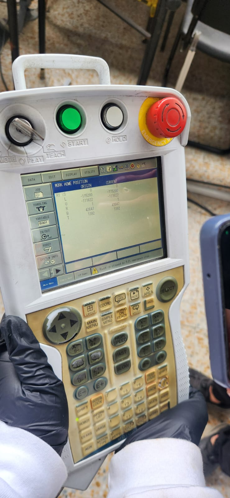
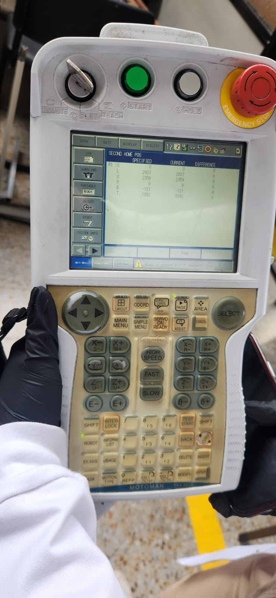
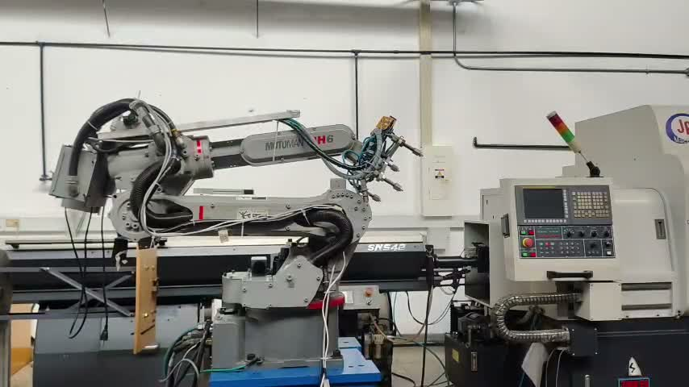
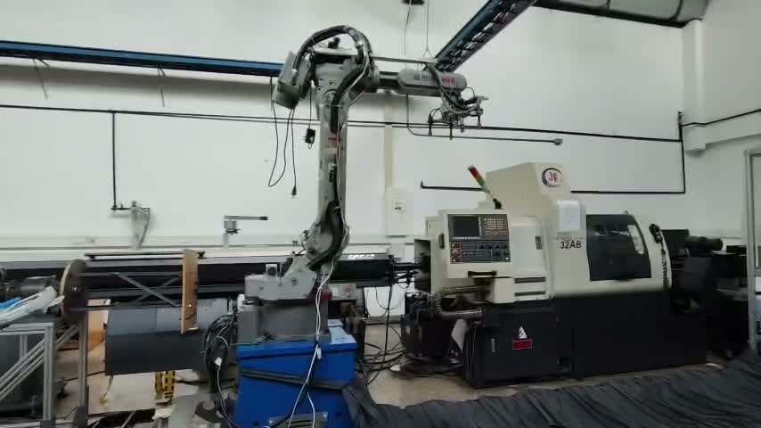
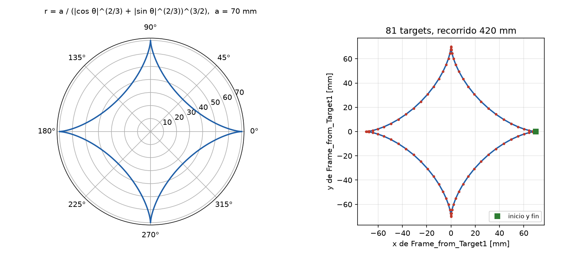
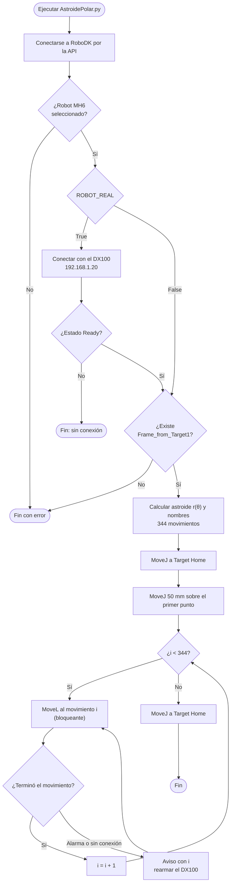
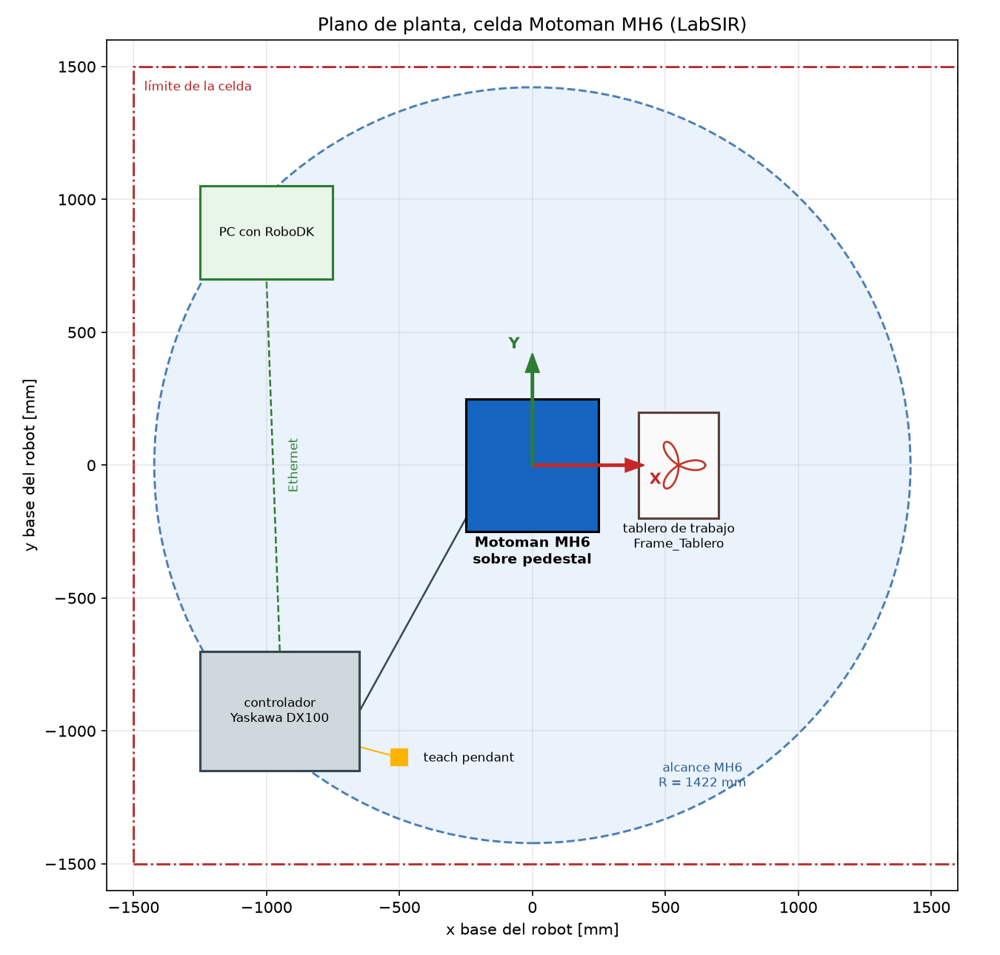
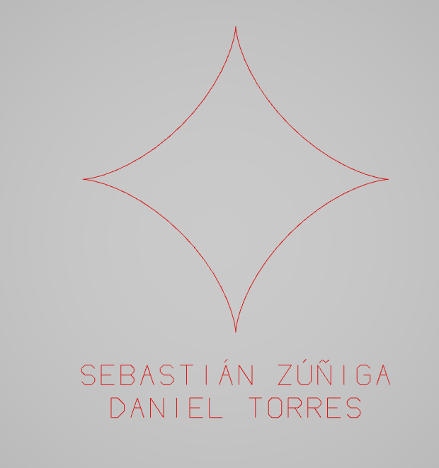
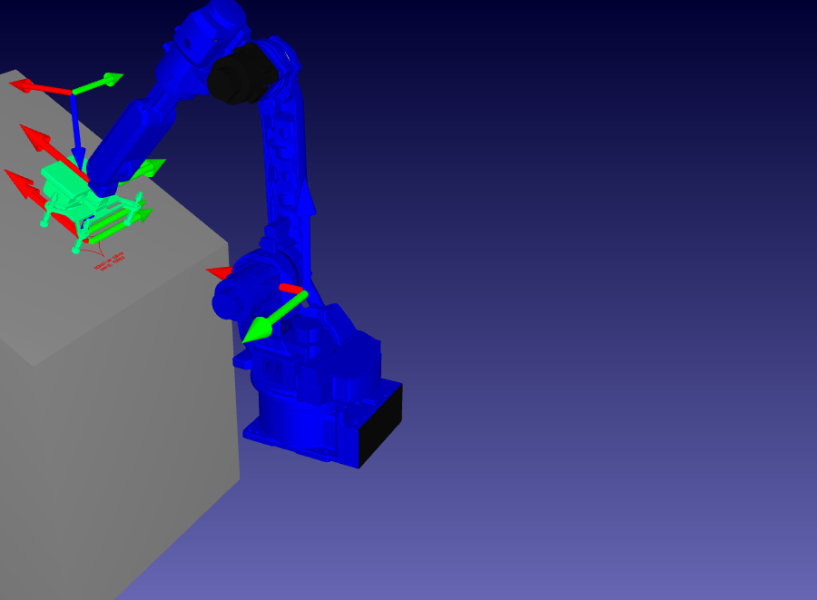

<picture>
  <source srcset="https://imgur.com/5bYAzsb.png" media="(prefers-color-scheme: dark)">
  <source srcset="https://imgur.com/Os03JoE.png" media="(prefers-color-scheme: light)">
  
</picture>

# Lab 02 - Robótica Industrial Motoman MH6 y RoboDK

## Grupo 3C

  
  
  
  

## 👥 Integrantes del grupo

| Integrante | Correo | GitHub |
|---|---|---|
| Daniel Alejandro Torres Sanabria | datorressa@unal.edu.co | [@DanielTorresS](https://github.com/DanielTorresS) |
| Janpier Sebastian Zuñiga Ramos | jzunigar@unal.edu.co | [@jzunigar](https://github.com/jzunigar) |

## 🎯 Objetivos

- Comparar las características técnicas del Yaskawa Motoman MH6 con las del ABB IRB 140.
- Identificar las configuraciones home1 y home2 del MH6, la posición de cada articulación y cuál conviene usar.
- Mover el MH6 manualmente desde el teach pendant por articulaciones y en cartesiano (traslaciones y rotaciones en X, Y, Z) y manejar los niveles de velocidad manual.
- Entender las aplicaciones de RoboDK, cómo mueve el manipulador y cómo se comunica con el DX100, y compararlo con RobotStudio.
- Programar una trayectoria polar en RoboDK con los nombres del grupo, simularla y ejecutarla en el MH6 comandado desde el PC.
- Equipos empleados: robot Yaskawa Motoman MH6 con controlador DX100 y teach pendant, PC con RoboDK conectado por Ethernet.

## 🧰 Recursos utilizados

- **Robot / simulador:** Yaskawa Motoman MH6 con controlador DX100; RoboDK con la estación del laboratorio (`Frame_from_Target1`, herramienta del laboratorio y `Target Home`).
- **Software:** RoboDK (simulación y ejecución en el robot por el driver de Motoman) y teach pendant del DX100 (movimiento manual y posiciones home).
- **Lenguaje / entorno:** Python con la API de RoboDK (`robodk`).
- **Evidencias adjuntas:**

| Carpeta | Contenido |
|---|---|
| [`robodk/AstroidePolar.py`](robodk/AstroidePolar.py) | Código de la trayectoria polar y los nombres (anexo de la guía) |
| [`media/fotos/`](media/fotos/) | Pantallas del pendant con home1 y home2 |
| [`media/img/`](media/img/) | Trayectoria programada, plano de planta, poses home y capturas de la simulación |
| [`media/videos/`](media/videos/) | Paso de home1 a home2 y trazado en el robot real |
| [`guia/`](guia/) | Guía del laboratorio |

## 📝 Desarrollo

### 1. Preparación

#### Motoman MH6 vs. ABB IRB 140

| Característica | Yaskawa Motoman MH6 | ABB IRB 140 |
|---|---|---|
| Tipo | Antropomórfico, 6 ejes | Antropomórfico, 6 ejes |
| Grados de libertad | 6 (S, L, U, R, B, T) | 6 (ejes 1 a 6) |
| Carga máxima en la muñeca | 6 kg | 6 kg |
| Alcance horizontal máximo | 1422 mm | 810 mm |
| Repetibilidad | ±0.08 mm | ±0.03 mm |
| Masa del manipulador | 130 kg | 98 kg |
| Rango eje 1 (S / 1) | ±170° | ±180° |
| Rango eje 2 (L / 2) | +155° / −90° | +110° / −90° |
| Rango eje 3 (U / 3) | +250° / −175° | +50° / −230° |
| Rango eje 4 (R / 4) | ±180° | ±200° |
| Rango eje 5 (B / 5) | +225° / −45° | ±120° |
| Rango eje 6 (T / 6) | ±360° | ±400° |
| Velocidad ejes 1 a 3 | 220 / 200 / 220 °/s | 200 / 200 / 260 °/s |
| Velocidad ejes 4 a 6 | 410 / 410 / 610 °/s | 360 / 360 / 450 °/s |
| Montaje | Piso, pared o techo | Piso, pared, invertido o en ángulo |
| Grado de protección | IP54 (muñeca IP67) | IP67 en todo el brazo |
| Controlador | Yaskawa DX100 | ABB IRC5 |
| Lenguaje | INFORM III (`.JBI`) | RAPID (`.mod` / `.sys`) |
| Simulador del fabricante | MotoSim EG-VRC | RobotStudio |
| Aplicaciones típicas | Manipulación, empaque, ensamble, dispensado, soldadura por arco ligera | Piezas pequeñas, ensamble, soldadura por arco, desbarbado, pulido, celdas compactas |

- Los dos cargan 6 kg, así que la diferencia está en el espacio de trabajo y la precisión. El MH6 tiene casi el doble de alcance; el IRB 140 es más preciso y compacto.
- La muñeca del MH6 es más rápida (hasta 610 °/s en T) y su eje U (+250° / −175°) le permite doblar el brazo hacia atrás.
- El IRB 140 es IP67 en todo el brazo; el MH6 estándar solo en la muñeca.

#### Home1 y home2

El pendant muestra estas posiciones en pulsos de encoder de cada eje; un valor cercano a 0 corresponde al cero mecánico.

| Posición | Pantalla del DX100 | S | L | U | R | B | T |
|---|---|---|---|---|---|---|---|
| Home1 | Work Home Position | 0 | −115290 | −111622 | 1 | 42647 | 1392 |
| Home2 | Second Home Pos | 0 | 2037 | 2359 | 0 | −121 | 1392 |

  
  

  
  

- **Home1** es la pose **recogida**: base al frente, brazo inferior L inclinado hacia atrás, brazo superior U plegado sobre él y muñeca doblada (B lejos de 0). Se lleva el robot con `[ROBOT]` → *Work Home Position* → `[FWD]` sostenido con el interruptor de habilitación.
- **Home2** es la pose **levantada**, casi en el cero mecánico: L vertical, U horizontal hacia adelante y muñeca estirada (B ≈ 0). El DX100 la usa para verificar la posición tras una alarma o un corte de energía: en *Second Home Pos* compara lo guardado contra lo actual (columna *Difference*, 0 en los seis ejes en la foto).

**¿Cuál es mejor?** Para trabajar, **home2**. Con el brazo levantado y la brida adelantada, el robot queda sobre la zona de trabajo y llega al tablero con movimientos cortos. Home1 no sirve como punto de partida: con el brazo plegado sobre la base hay que desplegar L y U por completo antes de alcanzar cualquier punto útil. Su uso es el **apagado**: es la pose en la que se deja el robot al terminar, compacta y con el brazo recogido para evitar desgaste. Como en home2 la muñeca está casi estirada (B ≈ 0, cerca de la singularidad de muñeca), conviene salir de ella con un movimiento articular (`MoveJ`) y no con uno cartesiano.

#### Movimiento manual

1. Encender el DX100, liberar las paradas de emergencia y poner la llave del pendant en **TEACH**.
2. Presionar **SERVO ON READY** y sostener el **interruptor de habilitación** (atrás del pendant) en la posición media. Si se suelta o se aprieta hasta el fondo, los servos se apagan.
3. Escoger el sistema de coordenadas con **COORD**; cada pulsación pasa al siguiente: `JOINT → XYZ (o CYLINDRICAL) → TOOL → USER`. Con `SHIFT` + `COORD` se escoge el número de herramienta.
4. Con el interruptor sostenido, mover con las teclas de eje. El robot se mueve solo mientras la tecla esté presionada.

| Par de teclas | En JOINT | En cartesiano |
|---|---|---|
| `X−/S−` `X+/S+` | Giro de la base S | Traslación en X |
| `Y−/L−` `Y+/L+` | Brazo inferior L | Traslación en Y |
| `Z−/U−` `Z+/U+` | Brazo superior U | Traslación en Z |
| `X−/R−` `X+/R+` | Giro del antebrazo R | Rotación alrededor de X |
| `Y−/B−` `Y+/B+` | Flexión de la muñeca B | Rotación alrededor de Y |
| `Z−/T−` `Z+/T+` | Giro de la brida T | Rotación alrededor de Z |

- **Traslaciones:** en XYZ, TOOL o USER, los tres pares superiores mueven el TCP en línea recta sin cambiar la orientación de la herramienta.
- **Rotaciones:** los tres pares inferiores giran la herramienta alrededor del TCP sin moverlo; por eso el TCP tiene que estar bien calibrado.
- En TOOL los ejes viajan con la herramienta (Z sale por la punta), lo que facilita entrar perpendicular a una superficie inclinada.
- El sistema activo se ve en el segundo ícono del área de estado de la pantalla.

#### Niveles de velocidad

| Nivel | En pantalla | Comportamiento |
|---|---|---|
| Inching | `INCH` | Cada pulsación mueve un incremento fijo muy pequeño y se detiene |
| Baja | `SLW` | Movimiento continuo lento |
| Media | `MED` | Movimiento continuo a velocidad intermedia |
| Alta | `FST` | Movimiento continuo rápido |

- **FAST** sube un nivel (`INCH → SLW → MED → FST`) y **SLOW** baja uno. **HIGH SPEED** junto con una tecla de eje mueve a velocidad alta solo mientras se mantiene presionada.
- En TEACH la velocidad del TCP queda limitada a la velocidad reducida de seguridad (250 mm/s) sin importar el nivel.
- **En pantalla:** el tercer ícono del área de estado (arriba a la derecha) muestra unos escalones con una letra: **I** inching, **L** baja, **M** media y **H** alta. Cambia con cada pulsación de FAST o SLOW.

### 2. Implementación

#### RoboDK: aplicaciones y comunicación con el MH6

RoboDK es un software de simulación y programación fuera de línea que no depende de un fabricante. Se usa para simular celdas (alcanzabilidad, límites, singularidades y colisiones), programar fuera de línea con un post-procesador que traduce al lenguaje de cada marca (para Motoman, INFORM en un `.JBI`), mover el robot real desde el PC, convertir trayectorias de CAM en movimientos del robot, calibrar y controlar toda la estación desde Python, C#, C++ o MATLAB.

**¿Qué hace para mover el manipulador?** Toma la trayectoria como una secuencia de targets, resuelve la cinemática inversa de cada uno con el modelo del MH6 escogiendo la configuración más cercana a la anterior, revisa alcanzabilidad, límites y singularidades, y según el modo simula, genera el `.JBI` o envía cada movimiento al DX100. RoboDK no controla los servos: el DX100 interpola y cierra los lazos de posición; RoboDK le dice a dónde ir, con qué tipo de movimiento y a qué velocidad.

**¿Cómo se comunica?** Hay dos caminos:

- **Por archivo:** RoboDK → post-procesador Motoman → `.JBI` → USB o FTP → DX100 en PLAY. El robot ejecuta sin el PC.
- **En línea (el que se usó):** PC y DX100 por Ethernet en la misma subred (IP `192.168.1.20`), driver de Motoman sobre el servidor Ethernet de alta velocidad del DX100 (UDP) y llave del pendant en **REMOTE**. Con *Connect to robot* el estado pasa a *Ready* y el programa se ejecuta en el robot mientras la simulación lo acompaña.

#### RoboDK vs. RobotStudio

| Aspecto | RoboDK | RobotStudio |
|---|---|---|
| Fabricante | Independiente | ABB |
| Robots soportados | Más de mil modelos de muchas marcas | Solo ABB |
| Simulación | Modelo cinemático propio; tiempo de ciclo aproximado | Controlador virtual con el RobotWare real; tiempos casi idénticos al robot |
| Lenguaje | Programa genérico + post-procesador | RAPID nativo |
| Programación por API | Python, C#, C++, MATLAB | Add-ins en C#, Smart Components |
| E/S y lógica de la celda | Básica | Completa: señales, Smart Components, transportadores |
| Configuración del controlador | No | Sí: EIO, parámetros, copias de seguridad |
| Sistemas operativos | Windows, Linux, macOS | Solo Windows |

- **RoboDK** sirve para cualquier marca, permite generar trayectorias matemáticas con pocas líneas de Python y corre en Linux; pero no ejecuta el software real del controlador, así que el blending o las alarmas del DX100 solo aparecen en el robot.
- **RobotStudio** es el gemelo digital de un robot ABB: lo que funciona en la simulación funciona en el robot, y tiene herramientas completas para la celda, como las que usamos en el Lab 01; pero solo sirve para ABB y solo en Windows.
- Para nosotros RobotStudio es la herramienta para poner en marcha una celda ABB con certeza; RoboDK es el puente entre las matemáticas de la trayectoria y cualquier robot: con el MH6 nos permitió moverlo desde el PC sin escribir INFORM a mano.

#### Trayectoria polar: astroide

La figura no podía ser una rosa polar, una elipse, un círculo ni una cardioide. Escogimos el **astroide**, $x^{2/3} + y^{2/3} = a^{2/3}$, que en polares queda:

$$
r(\theta) = \frac{a}{\left(|\cos\theta|^{2/3} + |\sin\theta|^{2/3}\right)^{3/2}}, \qquad a = 70\ \text{mm}
$$

  

- El polo es el origen de `Frame_from_Target1`; para cada θ se calcula $r(\theta)$ y se envía el punto $(r\cos\theta,\ r\sin\theta)$. La curva es cerrada y se dibuja de un solo trazo.
- Con θ uniforme los picos quedan mal muestreados, así que los ángulos se toman como $\theta_i = \mathrm{atan2}(\sin^3 u_i, \cos^3 u_i)$ con $u_i$ uniforme. Con **81 puntos** el error máximo frente a la curva es 0.08 mm (0.65 mm con θ uniforme), y como 81 − 1 es múltiplo de 4, los cuatro picos caen en puntos de la lista.
- Debajo del astroide se escriben **SEBASTIÁN ZÚÑIGA** y **DANIEL TORRES** con una fuente de trazo propia (letras de 9 mm sobre una rejilla de 4 × 6), levantando el marcador 10 mm entre trazos.

| Parámetro | Valor |
|---|---|
| Radio de los picos `a` | 70 mm |
| Puntos del astroide | 81 |
| Movimientos en total (astroide + nombres, con bajadas y subidas) | 344 |
| Tamaño del astroide | 140 × 140 mm |
| Velocidad lineal | 50 mm/s |
| Redondeo entre puntos | 1 mm |
| Altura segura | 50 mm sobre el tablero (hacia −z del frame) |

#### Organización del código

[`AstroidePolar.py`](robodk/AstroidePolar.py) sigue la estructura del `RosPolar.py` del docente:

| Sección | Contenido |
|---|---|
| 1 | Conexión a RoboDK y, con `ROBOT_REAL = True`, al DX100 en `192.168.1.20` |
| 2 | `Frame_from_Target1`, herramienta activa, velocidad y redondeo (leídos de la estación, no se redefinen) |
| 3 | Parámetros y cálculo del astroide en polares |
| 3b | Nombres de los integrantes con la fuente de trazo |
| 4 | `Target Home` y aproximación a altura segura sobre el primer punto |
| 5 | Dibujo punto a punto y regreso a `Target Home` |

Correcciones respecto al `RosPolar.py`: redondeo de 5 a 1 mm, de 720 a 81 puntos (720 satura el buffer del DX100), altura segura hacia −z (el z del frame apunta al tablero), conexión al robot habilitada y velocidad de 300 a 50 mm/s.

Los movimientos se envían con `MoveL` bloqueante: el siguiente sale solo cuando el robot terminó el anterior. Si el robot se detiene con HOLD, RoboDK espera; si salta una alarma o se pierde la conexión, el script muestra el movimiento en el que iba y, al rearmar el DX100, continúa desde ahí (o se reanuda después con `inicio = <n>`).

#### Diagrama de flujo

#### Plano de planta

  

| Elemento | Ubicación |
|---|---|
| Motoman MH6 | Origen, sobre el pedestal |
| Tablero de trabajo | Centro en (550, 0) mm, 300 × 400 mm; su centro es el origen de `Frame_from_Target1` y el polo de las coordenadas polares |
| Controlador DX100 | Detrás y a la izquierda del robot |
| Teach pendant | Junto al DX100 |
| PC con RoboDK | Fuera del alcance del robot, conectado por Ethernet |

El tablero está a 550 mm de la base, cerca de la mitad del alcance (1422 mm): el robot alcanza todo el trazo sin estirar el brazo y con la muñeca lejos de la singularidad.

### 3. Resultados

**En RoboDK** se simuló la trayectoria completa sobre la estación del laboratorio: el robot sale de `Target Home`, traza el astroide, escribe los dos nombres y vuelve a `Target Home`, sin problemas de alcanzabilidad.

  
  

**En el robot real** se conectó RoboDK con el DX100 en REMOTE y el MH6 ejecutó la trayectoria completa comandado desde el PC. La prueba se hizo con el marcador sin contacto con el tablero, así que en el video se ve el recorrido del robot pero no queda trazo dibujado; el resultado del dibujo se muestra con la simulación.

También se llevó el robot de home1 a home2 desde el pendant y se registraron los valores de ambas posiciones.

### 4. Análisis

- **Home1 vs. home2.** Home2, levantada y casi en el cero mecánico, deja el robot listo sobre la zona de trabajo y además sirve de referencia para verificar los encoders. Home1, recogida, es la pose de apagado: protege el robot cuando no se usa, pero desde ahí no se puede trabajar.
- **Número de puntos.** El compromiso es entre una curva poligonal y saturar el buffer del DX100. Repartir los puntos según el parámetro natural del astroide concentra la resolución en los picos: con 81 puntos se logra un error menor que con 161 repartidos uniformemente en θ.
- **Envío punto a punto.** Mandar cada `MoveL` solo cuando el anterior terminó evita llenar el buffer del controlador y permite reanudar la trayectoria desde el punto exacto si el robot se detiene.
- **Simulación vs. robot real.** RoboDK verifica geometría y alcanzabilidad, pero no corre el software del DX100: el comportamiento real (aproximación entre puntos, tiempos y alarmas) solo se comprueba en el robot, y por eso la primera prueba se hizo sin contacto.
- **RoboDK vs. RobotStudio.** Para el MH6, RoboDK permitió programar la trayectoria en Python sin escribir INFORM; RobotStudio da más certeza pero solo sirve para ABB.

## 📷 Evidencias

**Video de la práctica (canal oficial LabSIR):** https://youtu.be/mpTBdZYE0KI

**Simulación en RoboDK**

  

**Videos**

| Video | Contenido |
|---|---|
| [`trazado_robot_real.mp4`](media/videos/trazado_robot_real.mp4) | Robot real ejecutando el astroide y los nombres desde RoboDK |
| [`home1_a_home2.mp4`](media/videos/home1_a_home2.mp4) | El MH6 pasando de home1 (recogida) a home2 (levantada) |

## ✅ Conclusiones

- El MH6 y el IRB 140 cargan lo mismo, pero el MH6 tiene casi el doble de alcance y el IRB 140 es más preciso; la diferencia más grande al trabajar con ellos está en el ecosistema: INFORM y el pendant del DX100 frente a RAPID y RobotStudio.
- Home2 es la posición de trabajo, porque deja el robot sobre la zona de trabajo; home1 es la posición de apagado, recogida para evitar desgaste, y no sirve para trabajar desde ahí.
- Definir la figura en polares y muestrearla según su parámetro natural permitió dibujar el astroide con 81 puntos y un error de 0.08 mm, sin saturar el buffer del DX100.
- RoboDK permitió programar, simular y ejecutar la trayectoria en el MH6 desde Python sin escribir INFORM, con envío punto a punto que hace posible reanudar si el robot se detiene.

## 📚 Referencias

- Guía del Laboratorio No. 02 – Robótica Industrial 2026-II, Universidad Nacional de Colombia ([`guia/Guia_Laboratorio_02.pdf`](guia/Guia_Laboratorio_02.pdf)).
- Yaskawa Motoman. *MH6 Manipulator – Product specification*.
- Yaskawa Motoman. *DX100 Controller – Operator's manual*.
- *Referencia para principiantes DX100* (programación básica del DX100).
- RoboDK. *RoboDK API for Python – Documentation*.
- ABB Robotics. *Product specification – IRB 140*.

